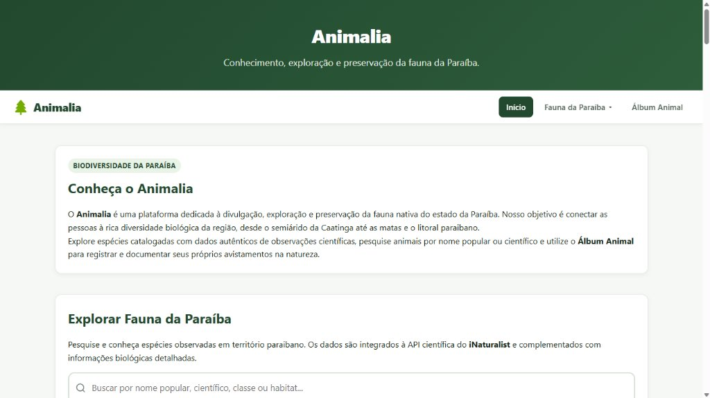
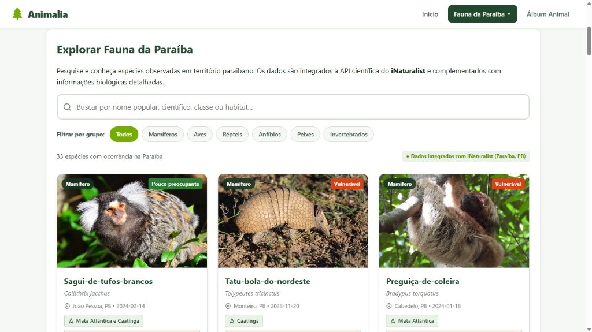
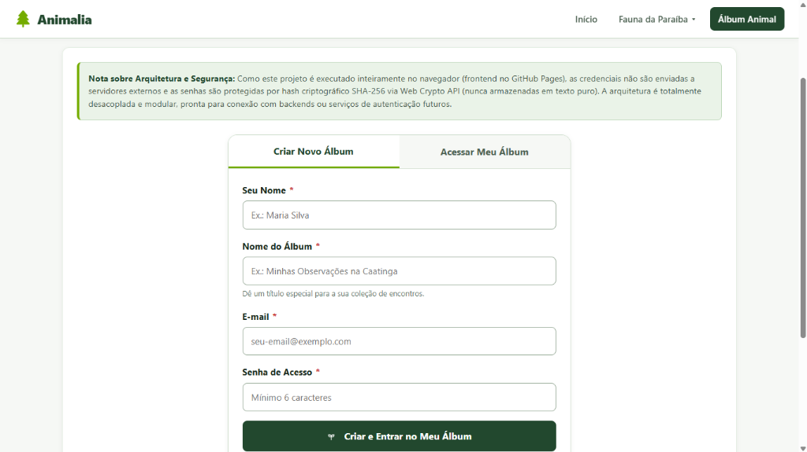
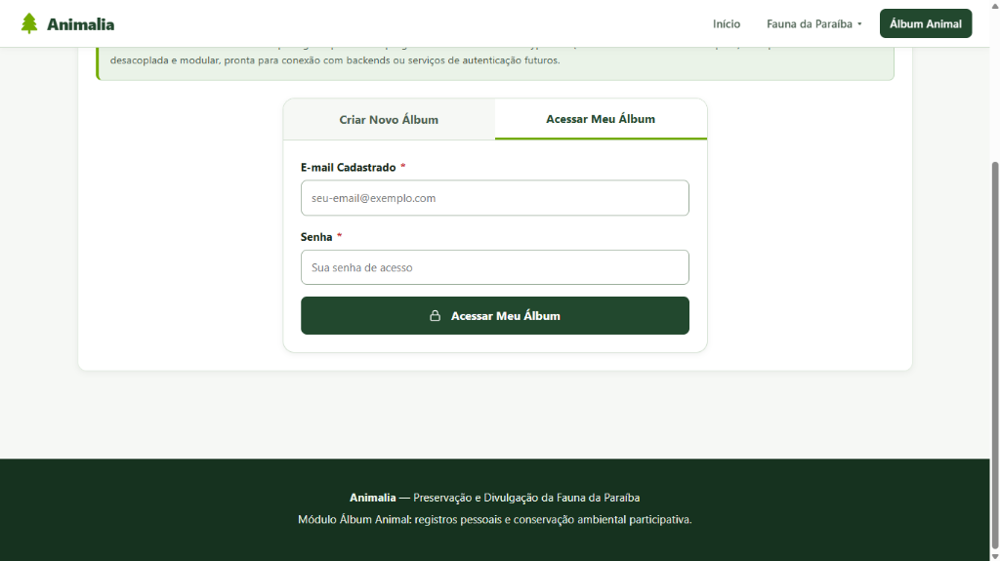
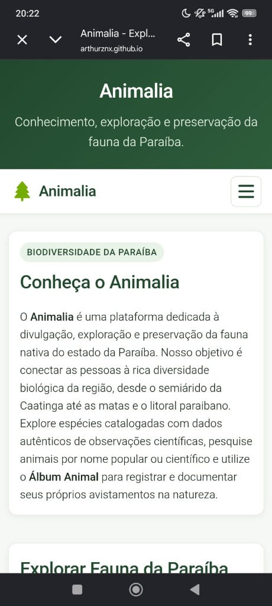
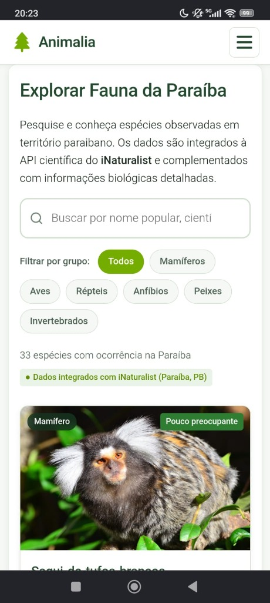
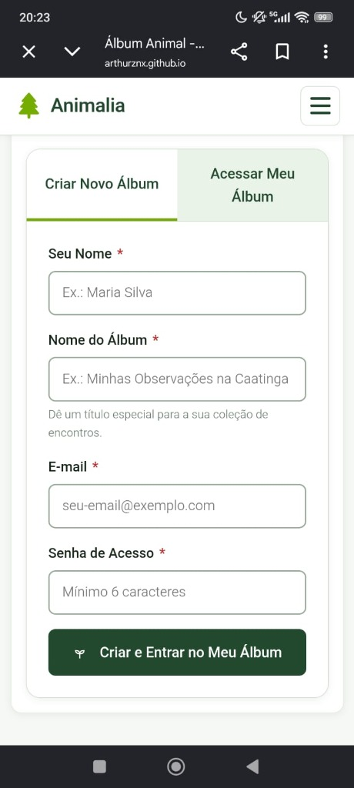
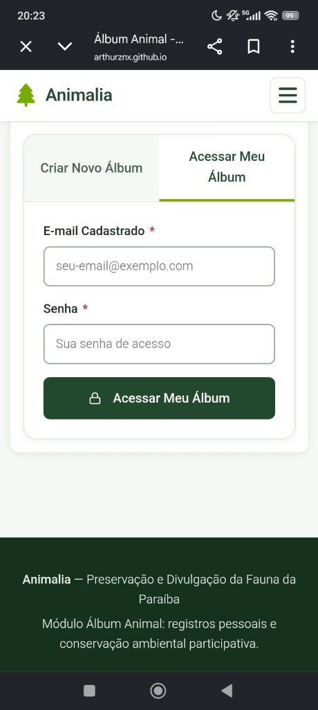

# Animalia — Conhecimento, Exploração e Preservação da Fauna da Paraíba

O **Animalia** é uma plataforma web interativa voltada à catalogação, valorização e preservação da fauna nativa do estado da Paraíba. Desenvolvida para estudantes, pesquisadores e entusiastas da biodiversidade, a aplicação reúne informações científicas autênticas sobre espécies dos biomas Caatinga e Mata Atlântica com fotografias de alta resolução e dados de conservação integrados ao iNaturalist. Além de explorar o catálogo, os usuários podem documentar seus próprios avistamentos e relatos de campo na natureza por meio do módulo participativo Álbum Animal.

---

## Tecnologias Utilizadas

* **HTML5:** Estruturação semântica com tags estruturais (`header`, `nav`, `main`, `section`, `article`, `footer`, `dialog`), formulários interativos com validação nativa e acessibilidade WAI-ARIA.
* **CSS3:** Estilização moderna e responsiva utilizando variáveis customizadas no `:root`, Flexbox, CSS Grid, tipografia com `rem` e media queries para múltiplos viewports.
* **JavaScript (ES6+ puro):** Arquitetura modular nativa (`import`/`export`), manipulação assíncrona do DOM com `async/await` e `fetch`, persistência em `localStorage` e criptografia SHA-256 via Web Crypto API, sem uso de frameworks externos.

---

## Capturas de Tela da Aplicação

### Versão Desktop

#### Tela Inicial e Apresentação


#### Catálogo Interativo da Fauna Paraibana


#### Módulo Álbum Animal — Criação de Novo Álbum


#### Módulo Álbum Animal — Acesso ao Álbum


---

### Versão Mobile

| Tela Inicial | Catálogo de Espécies |
| :---: | :---: |
|  |  |

| Criar Novo Álbum | Acessar Álbum |
| :---: | :---: |
|  |  |

---

## Estrutura de Pastas

```text
Projeto-Integrador-FrontEnd--Arthur-Guilherme-/
├── assets/
│   ├── images/
│   │   ├── desktop-album-cadastro.png
│   │   ├── desktop-album-login.png
│   │   ├── desktop-catalogo-fauna.jpg
│   │   ├── desktop-home-inicio.jpg
│   │   ├── mobile-album-cadastro.jpg
│   │   ├── mobile-album-login.jpg
│   │   ├── mobile-catalogo-fauna.jpg
│   │   └── mobile-home-inicio.jpg
│   └── imagens/
│       └── placeholder-animal.svg
├── css/
│   ├── album.css
│   ├── reset.css
│   ├── style.css
│   └── variaveis.css
├── js/
│   ├── components/
│   │   ├── album-ui.js
│   │   ├── fauna-explorer.js
│   │   └── navigation.js
│   ├── services/
│   │   ├── album-service.js
│   │   ├── api-ninjas.js
│   │   ├── fauna-service.js
│   │   └── inaturalist.js
│   ├── album-main.js
│   └── main.js
├── album.html
├── index.html
└── README.md
```

---

## Como Executar a Aplicação

A aplicação foi desenvolvida com tecnologias puras da web (HTML5, CSS3 e JavaScript ES6 Modular). Para executá-la localmente:

### Opção 1: Execução com Live Server no Visual Studio Code (Recomendado)
Por utilizar módulos nativos do JavaScript (`import`/`export`), a execução via servidor HTTP local evita eventuais restrições de CORS impostas pelos navegadores ao abrir arquivos diretamente pelo protocolo `file://`:
1. Abra a pasta do projeto no **Visual Studio Code**.
2. Clique com o botão direito sobre o arquivo `index.html`.
3. Selecione a opção **"Open with Live Server"**.
4. O navegador abrirá automaticamente o projeto no endereço `http://127.0.0.1:5500/index.html`.

### Opção 2: Servidor HTTP Local via Linha de Comando
No terminal, dentro da pasta raiz do projeto:
* **Com Python 3:**
  ```bash
  python -m http.server 8000
  ```
  Acesse `http://localhost:8000` no seu navegador.
* **Com Node.js (npx serve):**
  ```bash
  npx serve .
  ```

### Opção 3: Execução Direta pelo Navegador
Dê um duplo clique no arquivo `index.html` ou arraste-o para o navegador de sua preferência.

---

## Mapa dos Requisitos da Atividade

A tabela a seguir relaciona detalhadamente cada item da **Seção 2 da Atividade** à sua respectiva situação e evidência no código-fonte da aplicação:

| Requisito da atividade | Situação | Localização no projeto | Justificativa |
|---|---|---|---|
| **2.1 Repositório público no GitHub chamado projeto-integrador-frontend-[seunome]** | Implementado | Configuração do Repositório | Repositório público configurado no GitHub com a nomenclatura `Projeto-Integrador-FrontEnd--Arthur-Guilherme-`. |
| **2.1 Estrutura de pastas em minúsculas e sem espaços** | Implementado | Raiz do projeto (`css/`, `js/`, `assets/images/`) | Todos os nomes de pastas e arquivos utilizam caracteres minúsculos, sem espaços ou caracteres especiais, seguindo padrão modular. |
| **2.1 Caminhos de arquivo relativos (sem erro 404 no DevTools)** | Implementado | `index.html` (linhas 13-16, 364), `album.html` (linhas 13-16, 416) | Todas as folhas de estilo, scripts e imagens utilizam caminhos relativos funcionais (`css/`, `js/`, `assets/`). |
| **2.1 Histórico de commits seguindo Conventional Commits em branches** | Implementado | Histórico Git (`git log`) | Histórico com dezenas de commits atômicos padronizados (`feat:`, `fix:`, `style:`, `refactor:`, `test:`, `docs:`) organizados por branches. |
| **2.1 A versão final está na branch main** | Implementado | Branches do repositório (`git branch`) | Desenvolvimento concluído e validado nas branches temáticas.|
| **2.1 README.md completo (conforme Seção 3)** | Implementado | `README.md` | Documento estruturado contemplando com fidelidade todos os sete tópicos exigidos pela atividade acadêmica. |
| **2.2 Estrutura HTML5 válida (DOCTYPE, lang, charset, viewport, title)** | Implementado | `index.html` (linhas 1-12), `album.html` (linhas 1-12) | Ambas as páginas possuem `<!DOCTYPE html>`, `lang="pt-BR"`, metatags `charset="UTF-8"`, configuração de viewport e títulos semânticos. |
| **2.2 Conteúdo básico (h1, parágrafo, lista ul 3+ itens, tabela de dados reais, link externo target="_blank", imagem com alt)** | Parcialmente implementado | `index.html` (linhas 22-26, 104-107, 315-350) | Possui `<h1>`, parágrafo descritivo, listas `ul`, imagens com `alt` e tabela detalhada de dados reais no modal de espécies; entretanto, não inclui link externo com `target="_blank"` e `rel="noopener noreferrer"`. |
| **2.2 Semântica estrutural (header, nav, main único, 2+ section com título, footer)** | Implementado | `index.html` (linhas 19, 21, 100, 102, 114, 352) | Emprego estrito de `header`, `nav`, elemento `main` único, seções temáticas com cabeçalhos estruturados e rodapé semântico `footer`. |
| **2.2 Formulário coerente (4+ campos, label associado, fieldset/legend, required 2+, min/max ou pattern, botões/links)** | Parcialmente implementado | `album.html` (linhas 119-178, 262-350) | Contém formulário com mais de 8 campos, labels associados via `for`/`id`, campos com `required`, `min="1"` e `max="1000"`, elementos clicáveis exclusivamente com `<button>`; contudo, utilizou agrupamento por `div` em vez das tags `<fieldset>` e `<legend>`. |
| **2.2 Mídia (video ou audio com 2+ formatos, preload justificado, poster e track)** | Não implementado | Não localizado no código atual | O projeto continha reprodutor de áudio na branch `feature/audio-multiformato`, mas o recurso foi removido deliberadamente para focar a aplicação na exploração visual do catálogo científico e na integração com o iNaturalist. |
| **2.2 Gráfico (SVG ou Canvas ligado ao tema, fallback e responsivo)** | Parcialmente implementado | `index.html` (linhas 33-41, 124, 137, 174), `album.html` (linhas 34-42) | Implementa múltiplos elementos vetoriais SVG responsivos com `viewBox` (logotipo da marca e ícones de ações/navegação); todavia, a tag `<canvas>` não foi utilizada no projeto. |
| **2.3 Arquivos css/reset.css e css/style.css ligados ao HTML com box-sizing global** | Implementado | `css/reset.css` (linhas 1-5), `index.html` (linhas 13-15) | Reset CSS e folha de estilos principal ligados em todas as páginas, aplicando universalmente `*, *::before, *::after { box-sizing: border-box; }`. |
| **2.3 5+ variáveis CSS no :root (cores, espaçamento, tipografia)** | Implementado | `css/variaveis.css` (linhas 5-87) | Mais de 40 variáveis CSS customizadas organizadas em paletas de cores (inspiradas no iNaturalist e Caatinga), tipografia, espaçamento e sombras. |
| **2.3 3+ classes reutilizáveis, 1+ ID e 1+ combinador CSS** | Implementado | `css/style.css` (linhas 30-150, 200-260) | Amplo uso de classes modulares (`.btn-primario`, `.card-animal`), seletores de ID (`#fauna`, `#inicio`) e combinadores descendentes, filhos diretos e de agrupamento. |
| **2.3 Box model aplicado explicitamente (padding, border, margin)** | Implementado | `css/style.css` (linhas 440-480, 520-560) | Espaçamentos de box model explicitamente configurados em containers, cards de espécies, botões e campos de formulário. |
| **2.3 Os 4 estados de link (:link, :visited, :hover, :active) na ordem correta** | Parcialmente implementado | `css/style.css` (linhas 85-115, 230-245) | Os estados interativos `:hover`, `:focus` e `:active` estão amplamente estilizados com transições, porém as regras específicas `:link` e `:visited` não foram declaradas explicitamente na folha de estilos. |
| **2.3 Tabela e lista estilizadas (border-collapse, padding, legibilidade)** | Implementado | `css/style.css` (linhas 949-975) | Tabela de detalhes biológicos com `border-collapse: collapse`, padding balanceado, bordas suaves e excelente contraste e legibilidade. |
| **2.3 Todo font-size em rem** | Implementado | `css/style.css` (linhas 12, 81, 89, 440-550), `css/variaveis.css` | 100% dos tamanhos tipográficos definidos na unidade relativa `rem`, garantindo escalabilidade para acessibilidade conforme a preferência de fonte do usuário. |
| **2.3 Navbar com Flexbox, estado .ativo, dropdown funcional e position sticky** | Implementado | `css/style.css` (linhas 100-220), `index.html` (linhas 20-56) | Barra de navegação em Flexbox com `position: sticky; top: 0`, classe `.ativo` no link da página atual, submenu dropdown funcional e botão hambúrguer para dispositivos móveis. |
| **2.3 Seção em Grid com pseudo-classe estrutural e animações com transform** | Parcialmente implementado | `css/style.css` (linhas 445-485, 720-740) | Grid responsivo com `repeat(auto-fill, minmax(280px, 1fr))` e animações de hover utilizando `transform: translateY(-4px)` e `transform: scale(1.05)`; entretanto, não foram utilizadas pseudo-classes estruturais como `:nth-child` ou `:first-child`. |
| **2.3 Página legível em celular e desktop (modo responsivo)** | Implementado | `css/style.css` (linhas 1000-1120), `assets/images/` | Layout totalmente adaptável com breakpoints em 992px, 768px e 480px, com legibilidade comprovada em capturas desktop e mobile. |
| **2.4 Lógica JS: padrão dados -> classificar -> resumir com loops e condicionais** | Parcialmente implementado | `js/services/fauna-service.js`, `js/components/album-ui.js` | Padrão aplicado no processamento taxonômico e nas estatísticas do álbum com `if/else`, acumuladores e `for...of`; todavia, estruturas `switch` e `while/do...while` não foram mantidas na versão modular final. |
| **2.4 Funções e escopo: 2+ funções, const/let (sem var), coerção explícita, escopo local** | Implementado | `js/services/fauna-service.js` (linhas 29-46, 780-870) | Dezenas de funções puras e utilitárias (`resolverEspecieTaxonomica`, `validarEspecieCompleta`), ausência total de `var`, coerção explícita (`Number()`, `String()`, `Boolean()`) e escopo modular estrito. |
| **2.4 Arrays e DOM: map, filter e reduce, createElement e classes CSS** | Implementado | `js/components/fauna-explorer.js` (linhas 77, 120-131), `js/components/album-ui.js` (linhas 505-520) | Emprego conjunto de `map`, `filter` e `reduce` para agregação de dados e totalizadores, além de injeção dinâmica de elementos via `createElement` e manipulação de classes CSS. |
| **2.4 Eventos: acessibilidade via teclado, delegação de eventos, busca em tempo real, resumo dinâmico, proteção XSS** | Implementado | `js/components/fauna-explorer.js` (linhas 30-100, 240-270), `js/components/album-ui.js` | Controles com `aria-expanded`, delegação de eventos em elementos dinâmicos, busca por evento de `input`, resumo dinâmico e proteção total contra injeção de HTML malicioso via `textContent`. |
| **2.4 Script no final do body com defer/módulo unificado** | Implementado | `index.html` (linha 364), `album.html` (linha 416) | Scripts carregados no final do documento com `type="module"` (que possui execução diferida idêntica a `defer`), unificados e desacoplados em módulos organizados sem poluição de escopo global. |
| **2.4 Console do navegador sem erros ao abrir e interagir** | Implementado | Console do DevTools | Execução fluida sem erros ou exceções não tratadas no console do navegador, com tratamento resiliente de requisições de rede via blocos `try/catch`. |

---

## Limitações da aplicação

Por se tratar de uma aplicação não oficial e considerando a ausência de APIs específicas que disponibilizem um catálogo completo e confiável da fauna paraibana, não foi possível contemplar todas as espécies de animais existentes no estado. Dessa forma, o projeto apresenta uma seleção de espécies com informações disponíveis e busca demonstrar como a plataforma poderia funcionar em uma versão mais ampla, com maior reconhecimento, acesso a bases de dados especializadas e eventual reconhecimento oficial. Assim, a aplicação representa uma proposta demonstrativa de como seria possível consultar e explorar a diversidade da fauna da Paraíba em um sistema mais abrangente.

---

## Avaliações por pares

Data 02/09/2026 -- Avaliação em Pares

Projeto atende bem aos requisitos de HMTL, boa semântica , muito bem estruturado e comentado , só o áudio que não funcionou pra min, no geral projeto muito bom

Data 21/10/2026 - Avaliação

O projeto Animalia apresenta uma boa organização estrutural, com seções bem definidas e uma proposta interessante de análise de avistamentos de animais. Entretanto, não é possível afirmar que os conceitos da Aula 09/10 foram aplicados corretamente apenas pela análise do HTML. Para isso, é necessário verificar o JavaScript, especialmente o uso de variáveis, conversões de dados, condicionais, laços de repetição e acumuladores. Portanto, o projeto demonstra potencial, mas ainda precisamos analisar o arquivo logica.js para avaliar se está próximo de aplicar perfeitamente os conteúdos ensinados na aula. No entanto, o HTML está organizado e apresenta uma proposta de funcionalidade que pode ser utilizada para demonstrar os conceitos da aula. Isso é um ótimo começo.

Parabéns, mano! o projeto está ficando muito bom (na minha visão, claro kkkk)

---

## Autor

* **Nome completo:** Arthur Guilherme Silva Marques
* **RGM:** [47871024]
* **Curso:** [Análise e Desenvolvimento de Sistemas]

---
